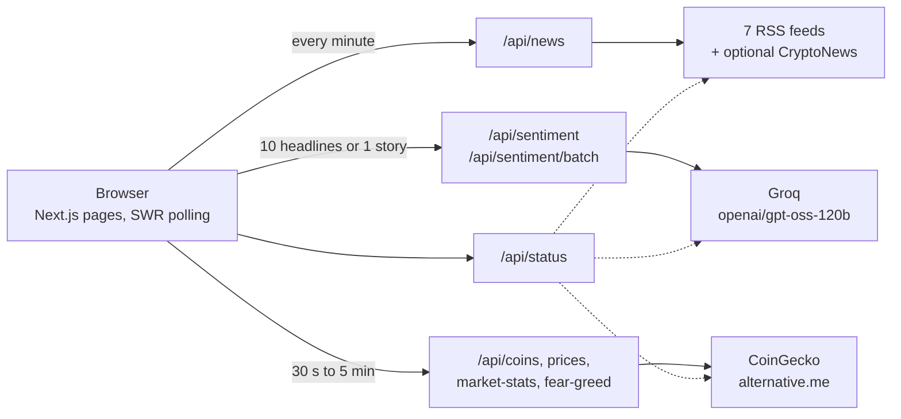
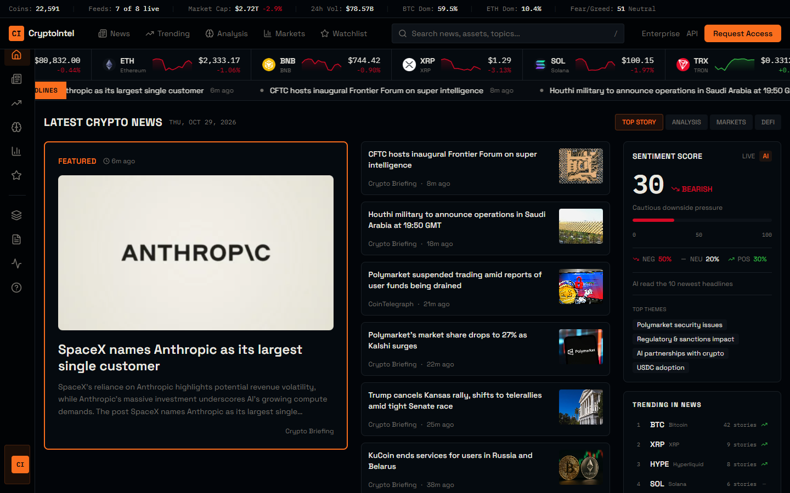
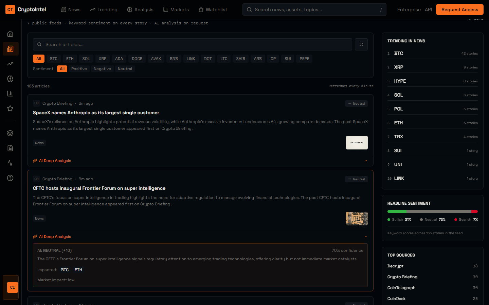
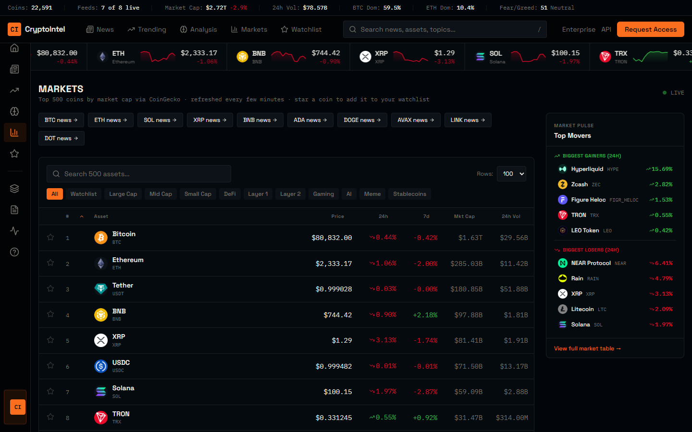
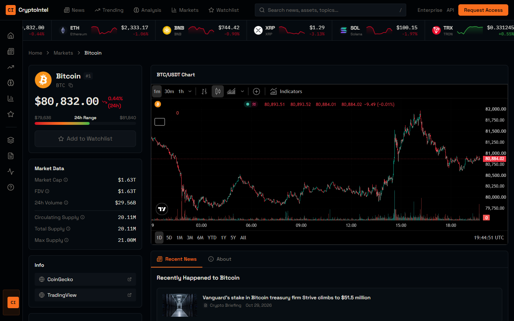
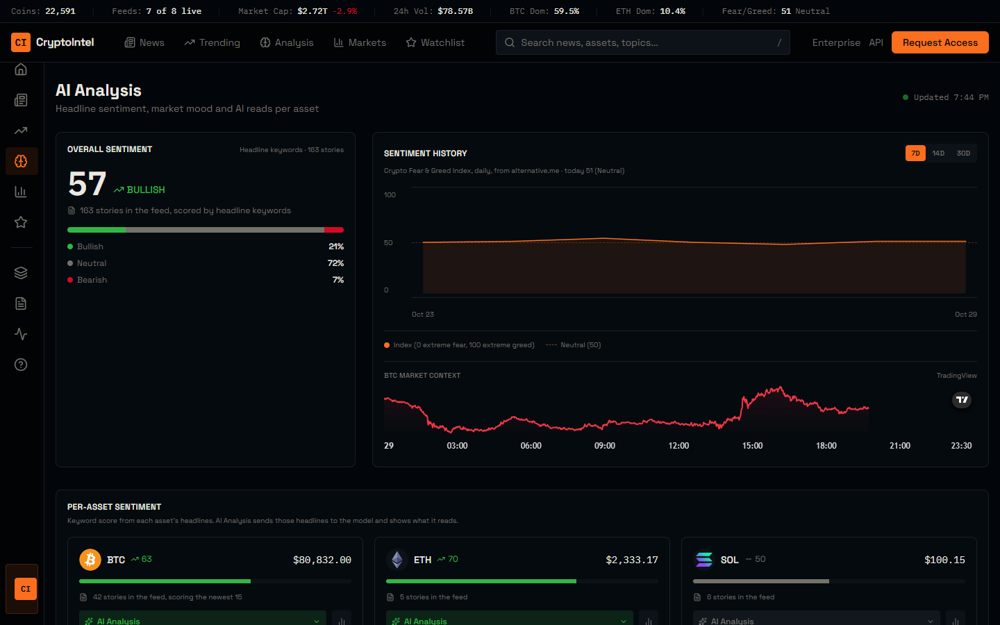

# CryptoIntel

Crypto news, its tone and the price move in one place. Seven public feeds and live market data come through thin API routes, every headline gets a keyword score, and an AI model reads the latest headlines on top.

**Live:** [cryptointel.site](https://cryptointel.site) | **Built:** March 2026, reworked October 2026

## The idea

CryptoIntel is one of a few conceptual attempts at an architecture I wanted out of my head and running. This one joins public sources to one front end through a thin server layer, with AI on top.

Each data route takes one kind of messy source, gives it one shape, caches it and survives the source failing. There is no database and no scheduled job. Freshness comes from cache expiry and the browser polling. Sentiment is layered: a cheap keyword score on every headline, then a model that reads the newest ten together and a deeper read of any single story on request.

## How it works

The front end is Next.js 16, React 19, Tailwind CSS 4 and shadcn/ui. Charts are TradingView widgets.

- `/api/news` reads seven RSS feeds in parallel (CoinDesk, CoinTelegraph, Decrypt, Bitcoin Magazine, NewsBTC, The Block, Crypto Briefing) with `Promise.allSettled`, so a dead feed only costs its own stories. It decodes, tags tickers and scores each headline, and an optional CryptoNews key adds a few more stories. Search and categories filter the whole feed.
- `/api/sentiment` and `/api/sentiment/batch` send one story or the latest headlines to `openai/gpt-oss-120b` on Groq and get JSON back: sentiment, a score, a summary and the coins it touches. A failure shows as a failure, not as a made-up score.
- `/api/coins`, `/api/prices`, `/api/market-stats` and `/api/fear-greed` read CoinGecko and alternative.me. They cache in memory, space their requests and serve the last good data when CoinGecko says no.
- `/api/status` runs a live check against every upstream, and the status page shows the result.

The watchlist lives in the browser, in one store every star and button shares.



## Status

Live and working as of 29 October 2026: the news feed, keyword and AI sentiment, prices, the 500-coin table with real sparklines, coin pages, the watchlist and the status checks. The Enterprise and API pages describe ideas for selling the feed. There are no accounts, API keys or billing behind them.

## How I built it

I wrote the concept and spec and built the first version by directing v0, Vercel's AI app builder. In October 2026 I reworked it with Claude Code: a current model, one shared watchlist, a working feed in place of a blocked one, real numbers where there were placeholders, site copy that matches the code, and type errors no longer ignored at build time. I don't hand-write the code.

## Screenshots











## Run it locally

You need Node.js 20 or later and pnpm.

```bash
pnpm install
pnpm dev
```

Copy `.env.example` to `.env.local` and set `GROQ_API_KEY` for the AI routes. `CRYPTONEWS_API_KEY` is optional. The feeds and CoinGecko need no keys. The Formspree form id is masked in this copy, so the forms won't send until you add your own.

This repository is a snapshot of the code as of 2026-10-29. The working repository is private.
